1) выборка всех данных из таблицы 

1.1 выборка всех данных из таблицы owner
select * from owner
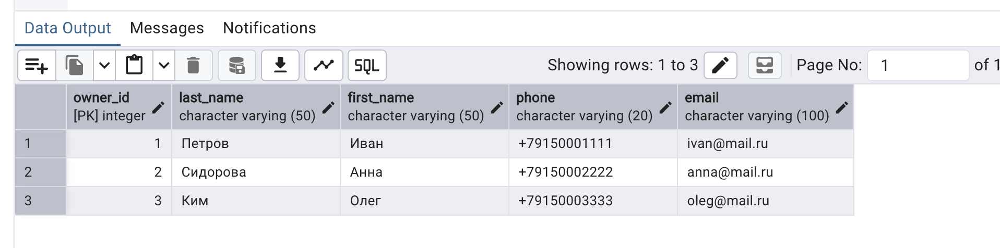

1.2 выбока всех данных из таблицы bike_model
select * from bike_model
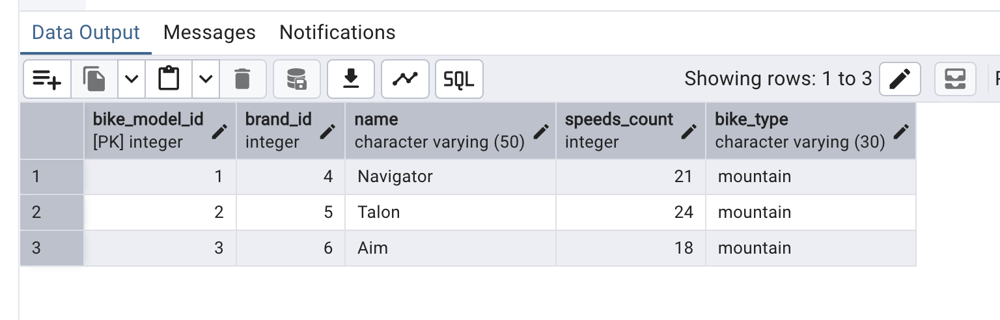

2) выборка отдельных столбцов

2.1 выборка модели и бренда из таблицы bike_model
select name, speeds_count from bike_model
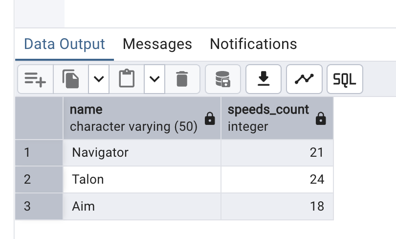

2.2 выборка last_name и first_name из таблицы owner
select first_name, last_name from owner
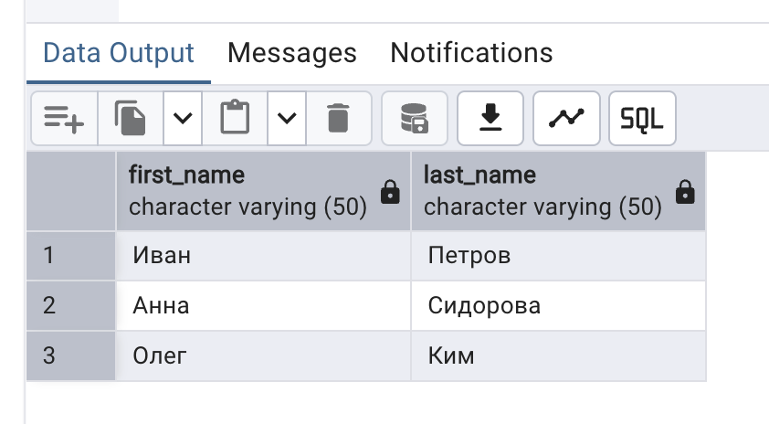

3) Присвоение новых имен столбцам при формировании выборки

3.1 чтобы у модели писалась "название модели" из таблицы bike_model
select name as "название модели" from bike_model
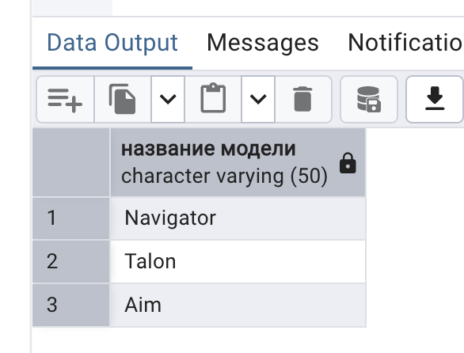

3.2 чтобы у first_name писалось "Имя владельца" из таблицы owner
select first_name as "Имя владельца" from owner
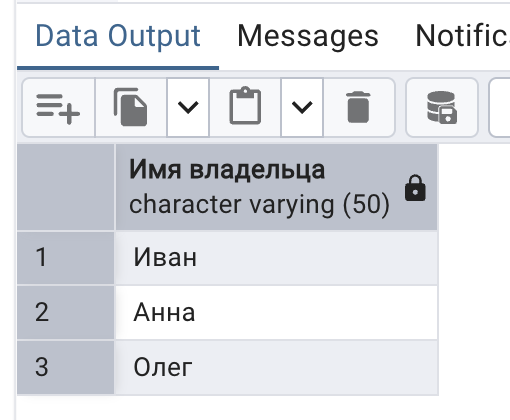

4) Выборка данных с созданием вычисляемого столбца

4.1 вывести capacity у airplane_model умножена на 2
select capacity * 2 as "Вместимость умноженная на 2" from airplane_model
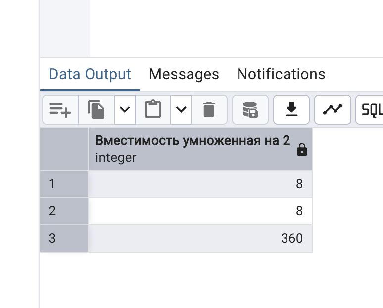

4.2 вывести speeds_count у bike_model была умножена на brand_id;
select speeds_count * brand_id as "Кол-во скоростей умноженное на id бренда" from bike_model
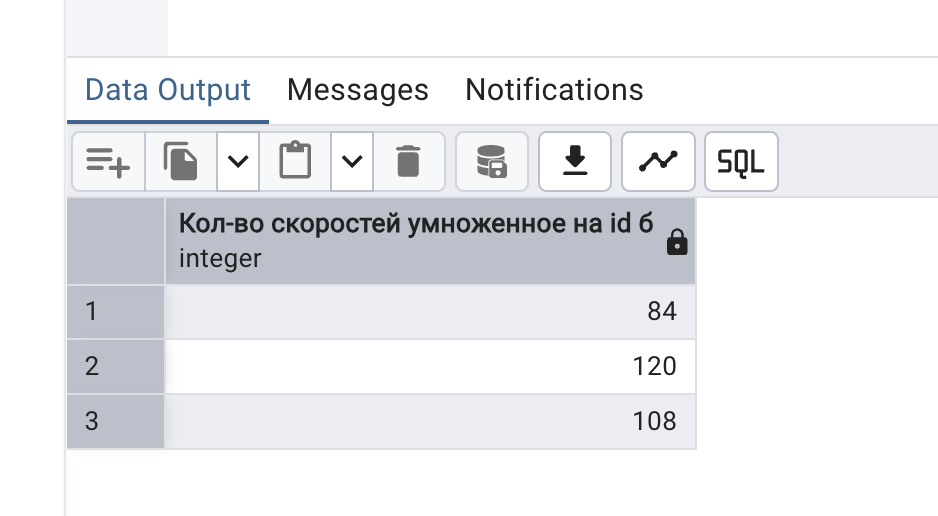

5) Выборка данных, вычисляемые столбцы, математические функции

5.1 вывести capacity у airplane_model под корнем 
select sqrt(capacity) as "Вместимость самолета под корнем" from airplane_model;
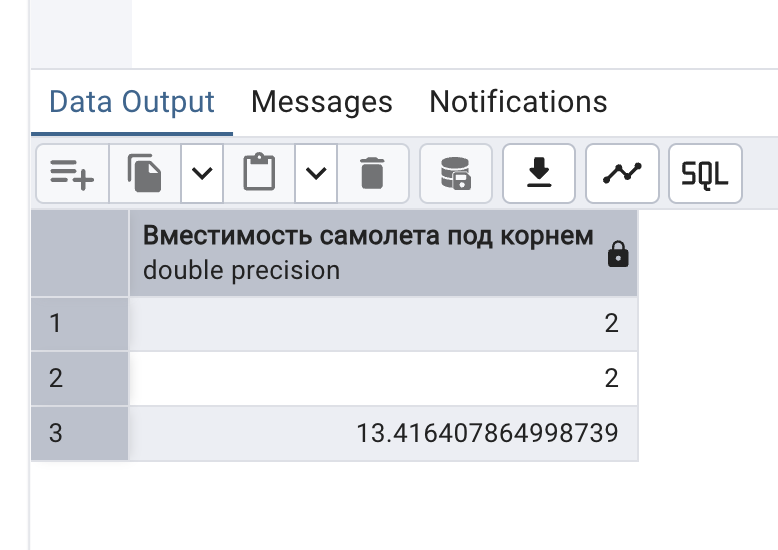

5.2 вывести факториал speeds_count у bike_model
select factorial(speeds_count) as "Факториал от кол-ва скоростей" from bike_model
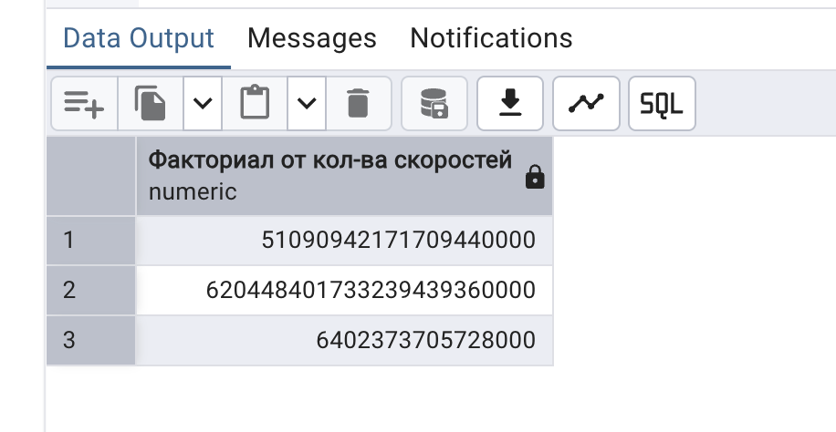

6) Выборка данных, вычисляемые столбцы, логические функции

6.1 Если capacity > 180 выводит, что самолет большой, иначе маленький
select capacity, name,
case when capacity > 100 then 'Большой' else 'Маленький самолет'
end as "Большой или маленький самолет"
from airplane_model
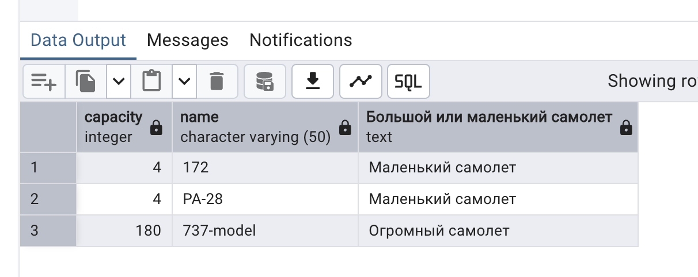

6.2 Если engine_cc > 500 выводит "Мощный мотоцикл", иначе "Слабый мотоцикл"
select engine_cc, name,
case when engine_cc > 500 then 'Мощный мотоцикл' else 'Слабый мотоцикл'
end as "Мощный или слабый мотоцикл"
from motorbike_model
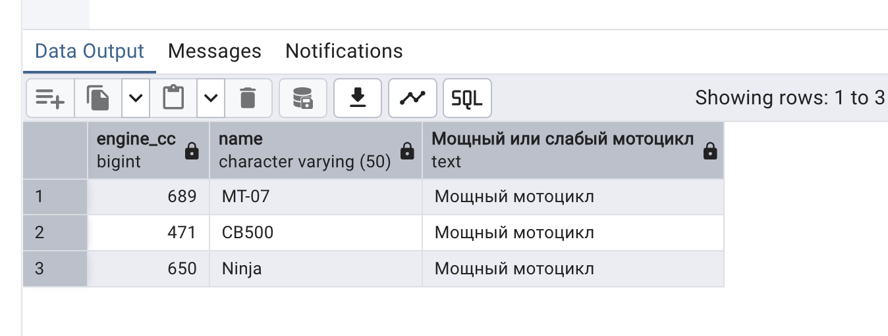

7) Выборка данных по условию

7.1 Вывести данные о airplane_model, если capacity > 100
select * from airplane_model where capacity > 100
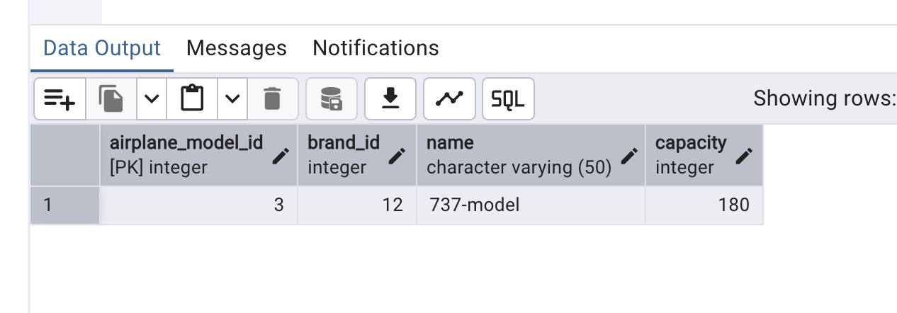

7.2 Вывести данные о car_model, если doors_count > 3
select * from car_model where doors_count > 3
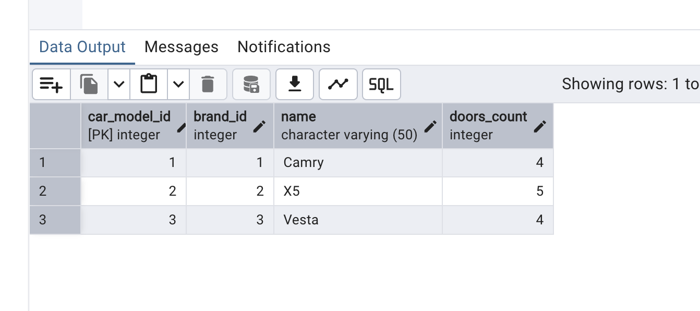

8) Выборка данных, логические операции

8.1 Вывести airplane_model_id у airplane_model, если capacity > 100
select airplane_model_id from airplane_model where capacity > 100
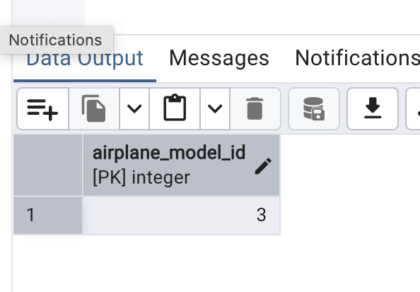

8.2 Вывести name у car_model, если doors_count > 3
select name from car_model where doors_count > 3
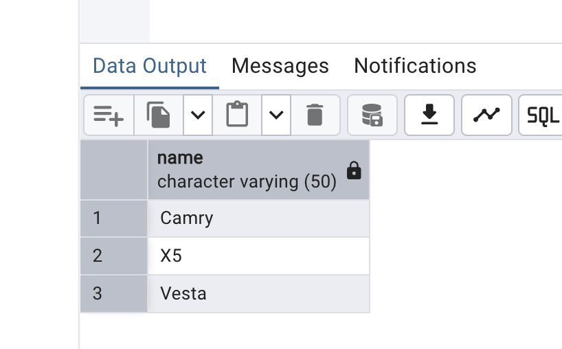

9) Выборка данных, операторы BETWEEN, IN

9.1 Вывести данные о motorbike_model, если engine_cc находится в диапазоне от 600 до 700
select * from motorbike_model where engine_cc between 600 and 700
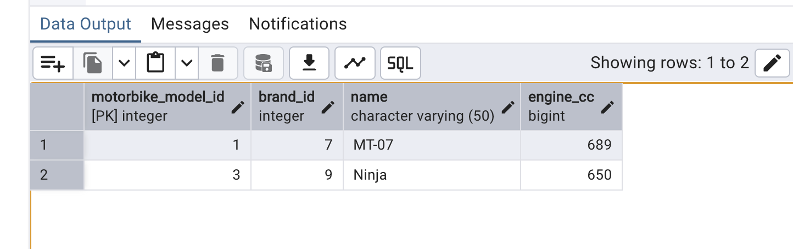

9.2 Вывести данные о bike_model, если doors_count находится в диапазоне от 20 до 25
select * from bike_model where speeds_count between 20 and 25
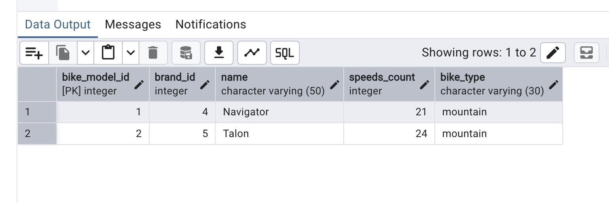

10) Выборка данных с сортировкой

10.1 Отсортировать bike_model по speeds_count
select * from bike_model order by speeds_count
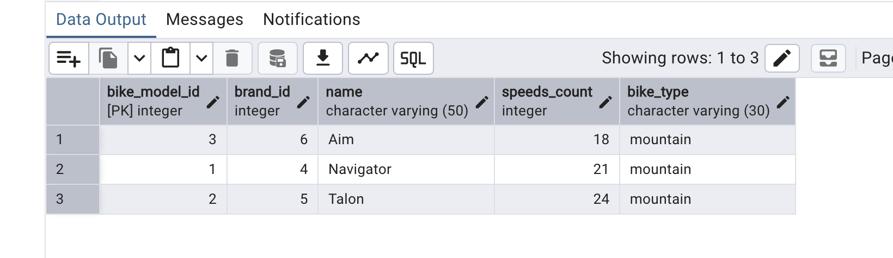

10.2 Отсортировать car_model по doors_count
select * from car_model order by doors_count
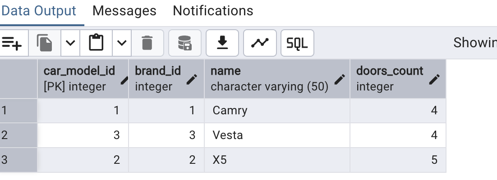

11) Выборка данных, оператор LIKE

11.1 Вывести данные о car_model у которых в name ровно 5 символов
select * from car_model where name like '_____'
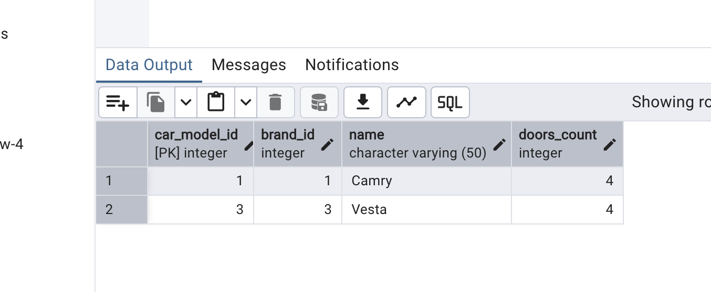

11.2 Вывести данные о car_model у которых в name больше 3 символов
select * from car_model where name like '___%'
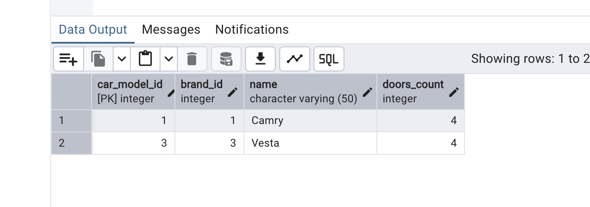

12) Выбор уникальных элементов столбца

12.1 Уникальные вместимости у airplane_model
select distinct capacity from airplane_model
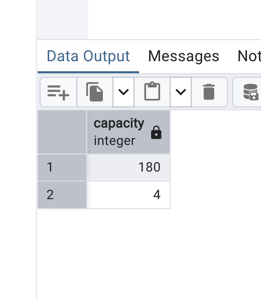

12.2 Уникальное кол-во дверей у car_model
select distinct doors_count from car_model
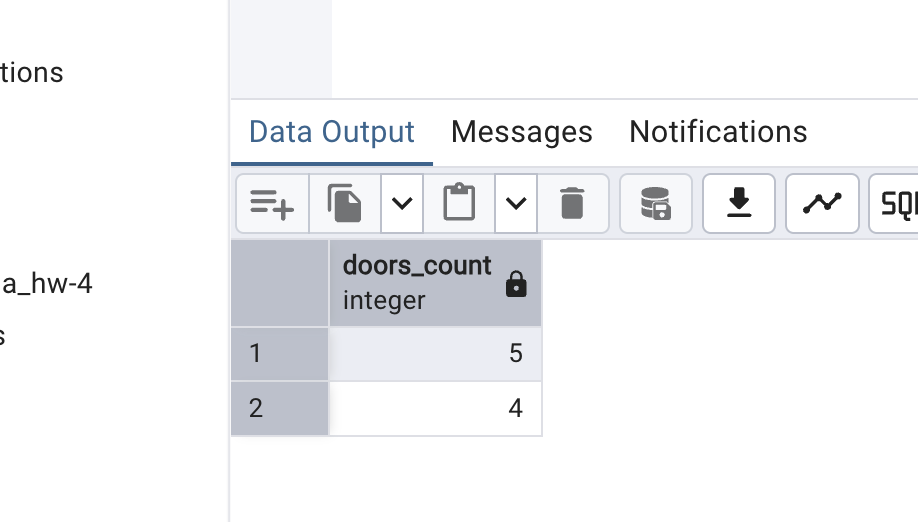

13) Выбор ограниченного количества возвращаемых строк.

13.1 Отсортировать bike_model по speeds_count и только первый
select * from bike_model order by speeds_count limit(1)
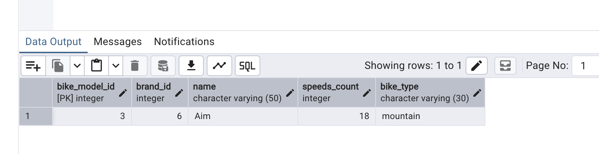

13.2 Отсортировать car_model по doors_count и только первые 2
select * from car_model order by doors_count limit(2)
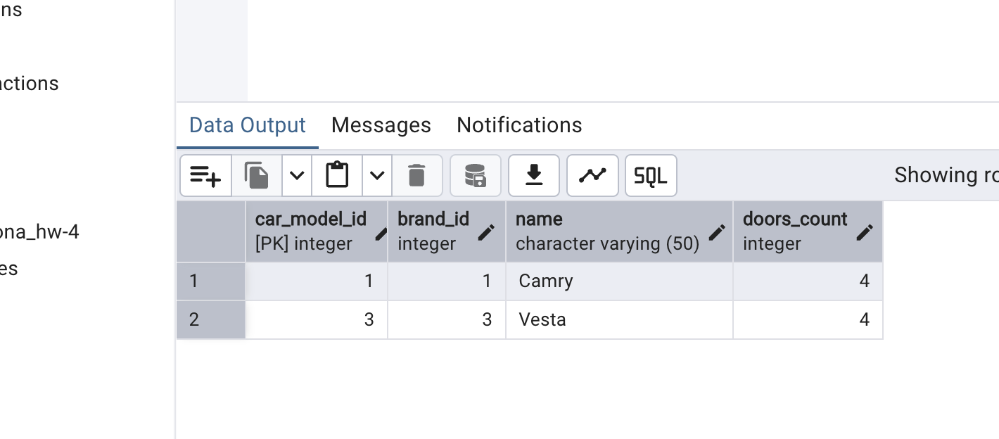

14) Соединение INNER JOIN

14.1 соединить велосипеды с их моделями по bike_model_id и вывести owner_id
select bi.owner_id from bike_model bm
join bike bi on bm.bike_model_id = bi.bike_model_id
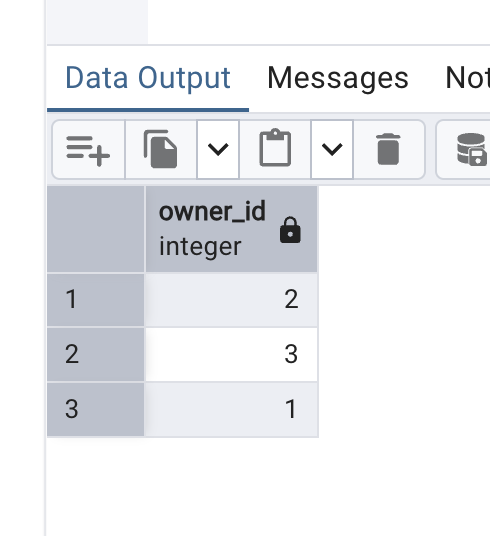

14.2 соединить самолеты с моделями и вывести name
select name from airplane ai
join airplane_model am on ai.airplane_model_id = am.airplane_model_id
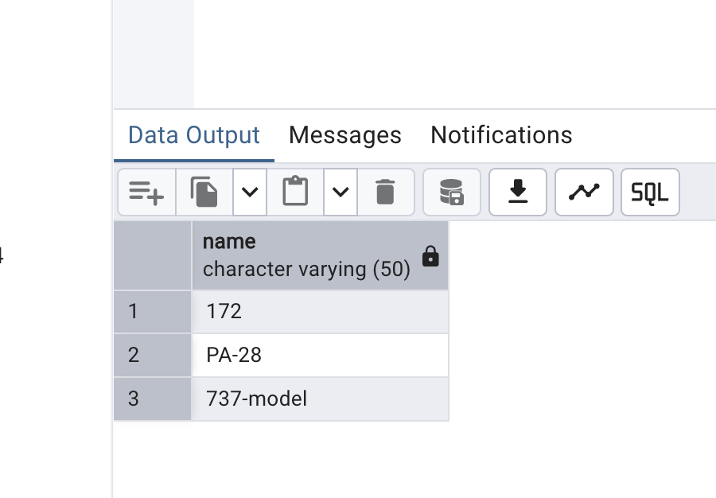

15) left

15.1 вывести всех владельцев и номера их машин, включая тех, у кого машин нет
select o.last_name, o.first_name, c.plate_number
from owner o
left join car c on o.owner_id = c.owner_id
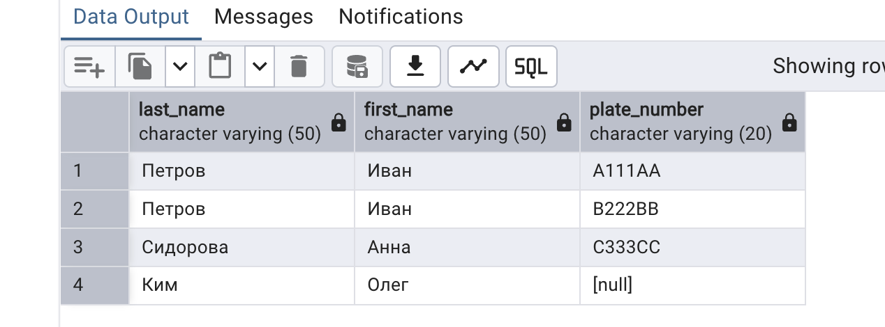

15.2 вывести все модели велосипедов и id владельцев, включая модели, которых ни у кого нет
select bm.name , bm.speeds_count, b.owner_id
from bike_model bm
left join bike b on bm.bike_model_id = b.bike_model_id
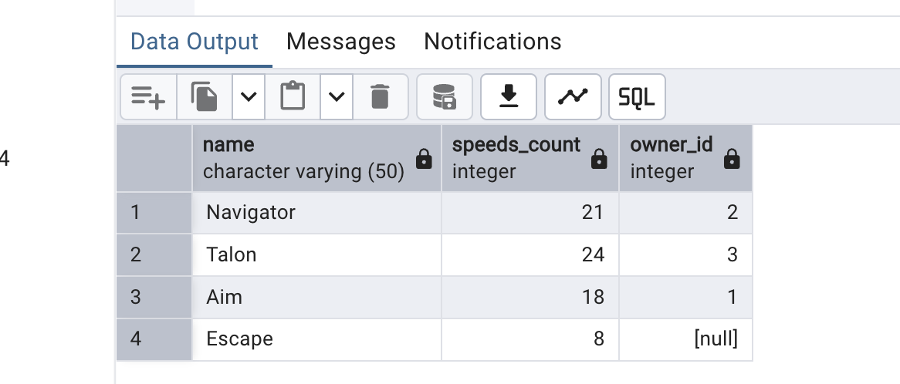

16) right

16.1 владелец и номер машины даже если у владельца нет машины
select o.last_name, o.first_name, c.plate_number
from car c
right join owner o on c.owner_id = o.owner_id
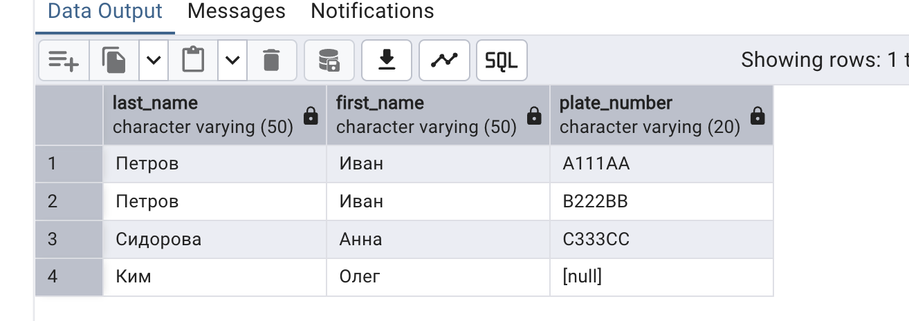

16.2 все модели машин и номера машин каждой модели даже если у модели нет машины
select cm.name, cm.doors_count, c.plate_number
from car c
right join car_model cm on c.car_model_id = cm.car_model_id
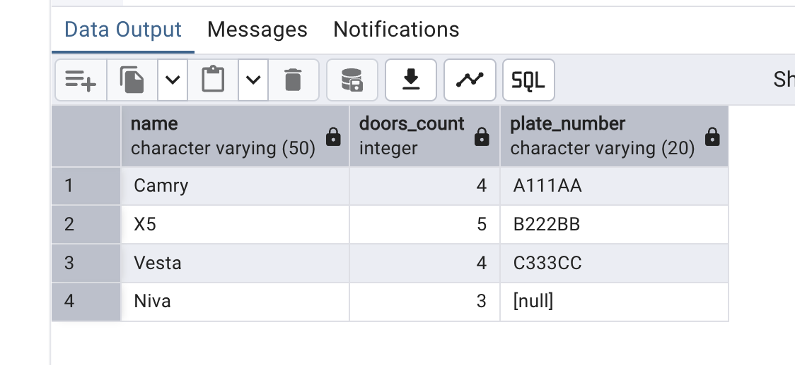

17) cross join

17.1 все возможные пары владелец — модель самолёта
select o.last_name, am.name from owner o cross join airplane_model am
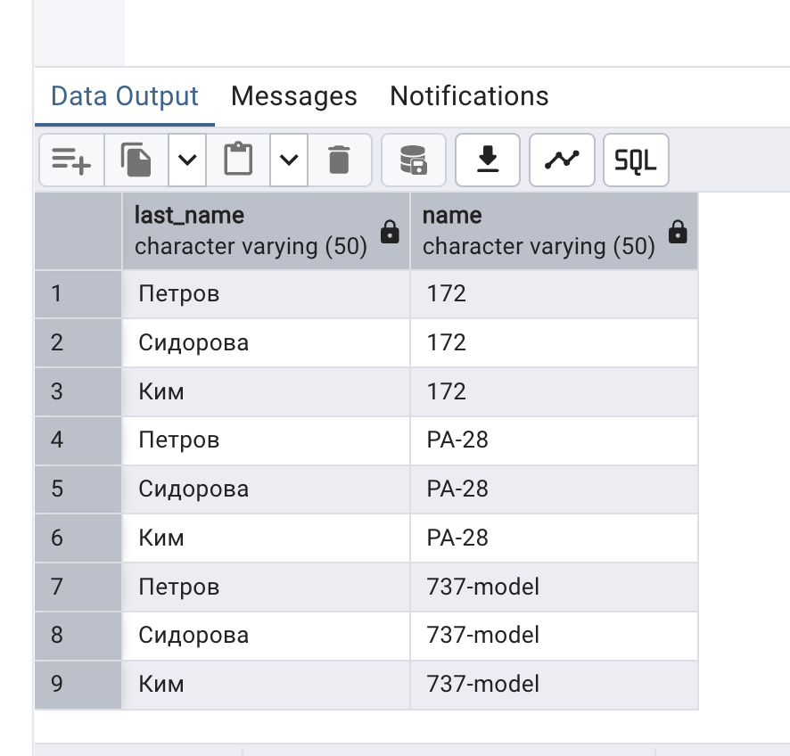

17.2 все пары владелец - модель лодки
select o.last_name, bm.name from owner o cross join boat_model bm
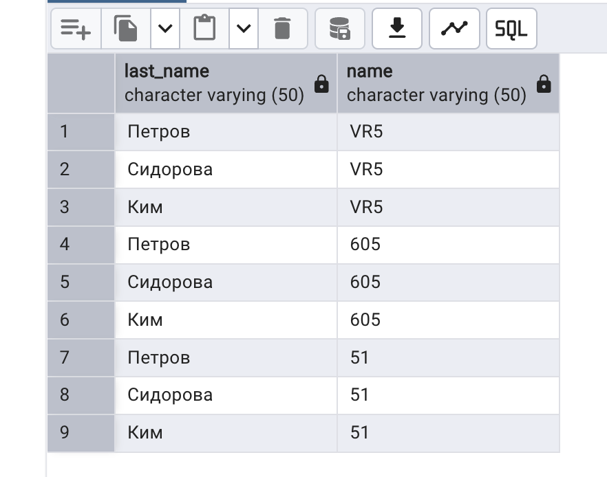

18) outher join

18.1 все владельцы и все машины вместе, даже если у владельца нет машины
select o.last_name, o.first_name, c.plate_number
from owner o
full outer join car c on o.owner_id = c.owner_id
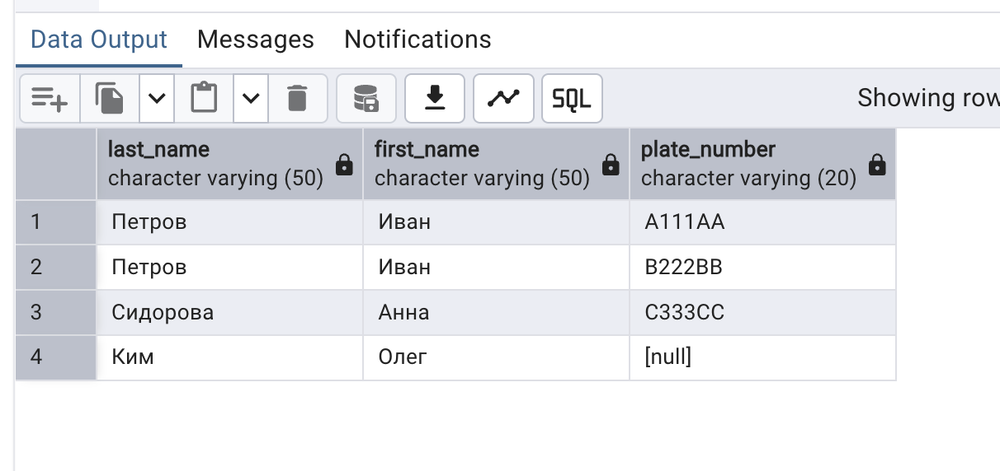

18.2 все модели велосипедов и все велосипеды вместе, даже если модели ни у кого нет
select bm.name, bm.speeds_count, b.owner_id
from bike_model bm
full outer join bike b on bm.bike_model_id = b.bike_model_id
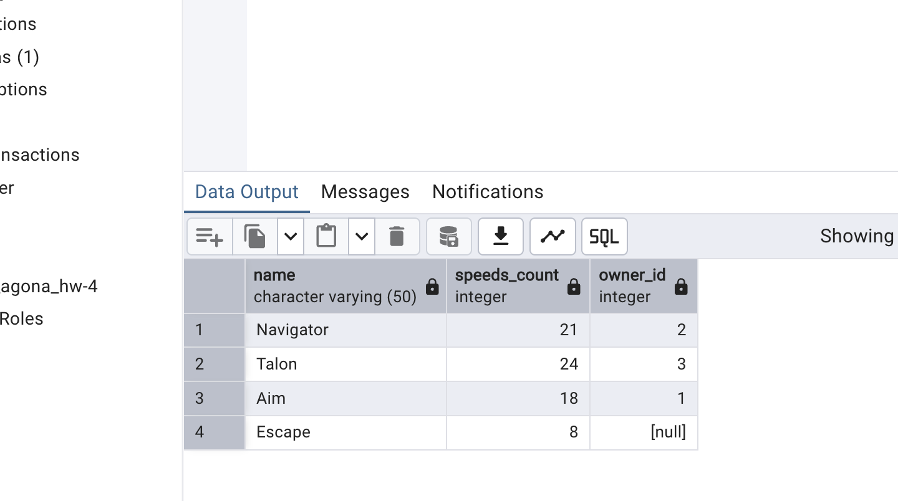