a) 1 - COUNT()

1.1 Вывести количество моделей у bike
select count(*) from bike_model;
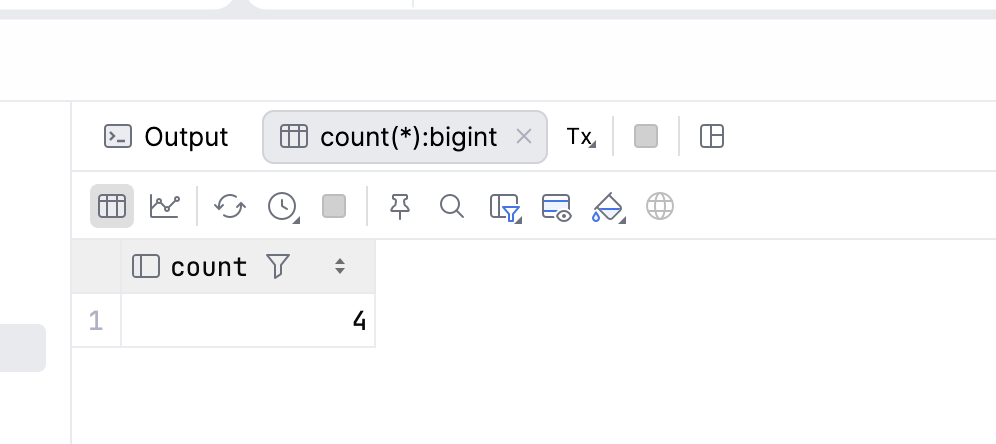

1.2 Вывести количество владельцев у owner
select count(*) from owner;

2 - SUM()

2.1 Вывести суммарную вместимость всех самолетов
select sum(capacity) from airplane_model;
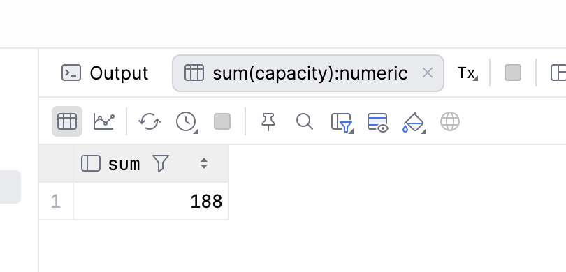

2.2 Вывести суммарное количество скоростей у велосипедов
select sum(speeds_count) from bike_model;
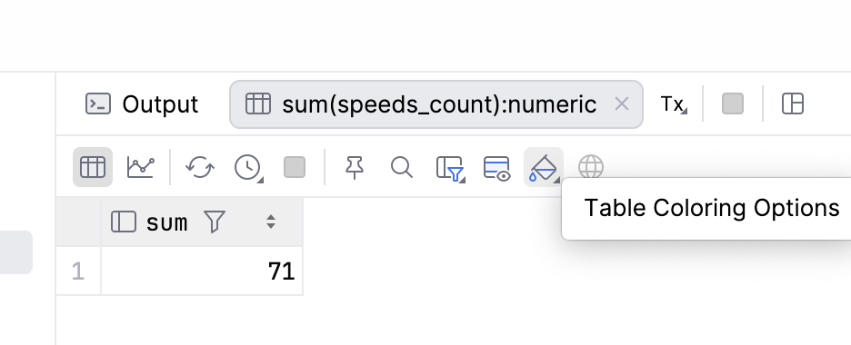

3 - AVG()

3.1 Вывести среднее количество дверей у всех машин
select avg(doors_count) from car_model;
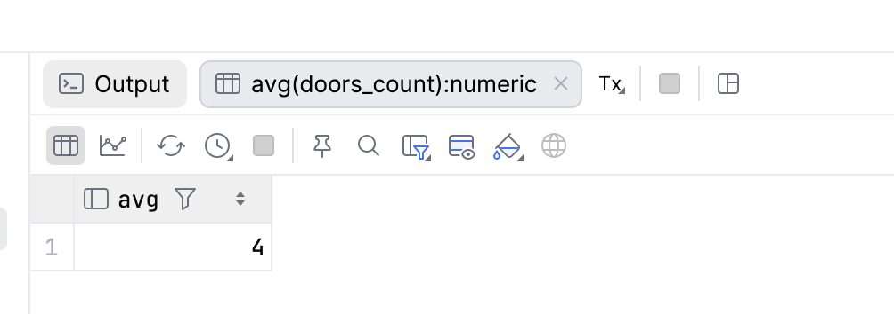

3.2 Вывести среднюю вместимость у всех самолетов
select avg(capacity) from airplane_model;
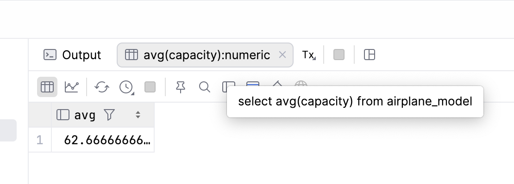

4 - MIN()

4.1 Вывести минимальный enginee_cc у motorbike_model
select min(engine_cc) from motorbike_model;
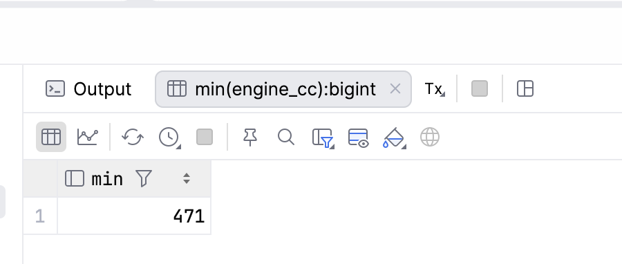

4.2 Вывести минимальную вместимость у самолетов
select min(capacity) from airplane_model;
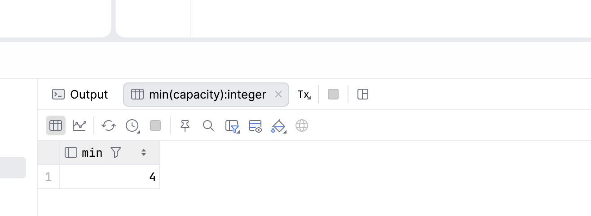

5 - MAX()

5.1 Вывести максимальный engine_cc у motorbike_model
select max(engine_cc) from motorbike_model;
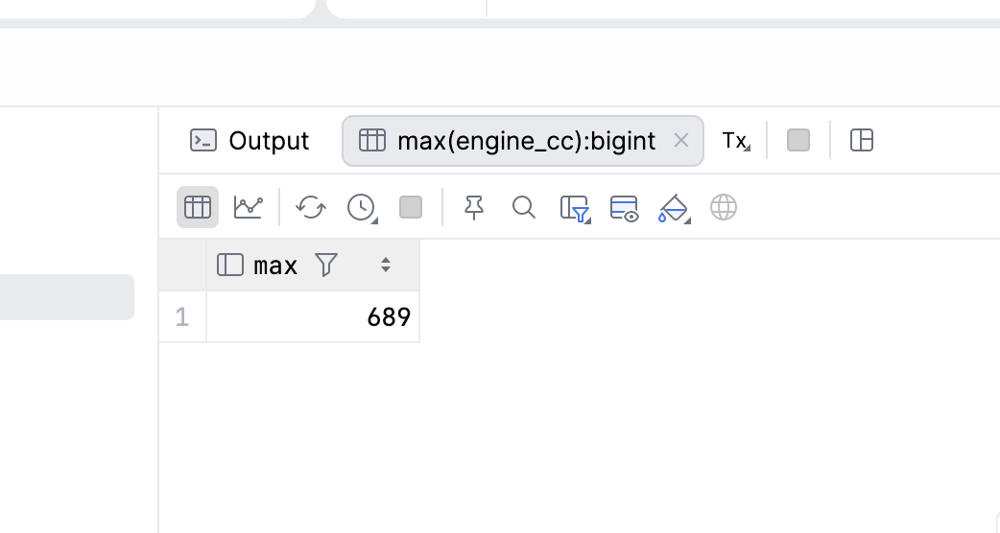

5.2 Вывести максимальную вместимость у самолетов
select max(capacity) from airplane_model;
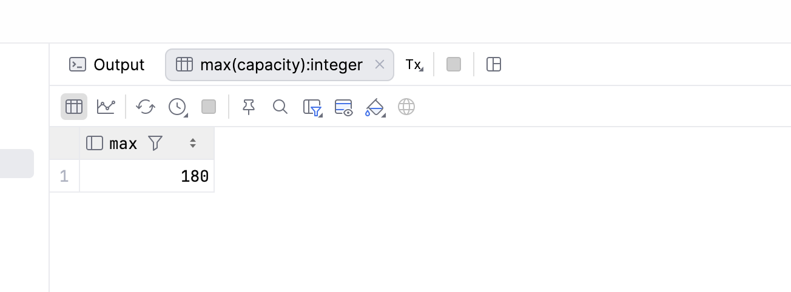

6 - STRING_AGG()

6.1 Вывести строковые значения у airplane_model
select String_agg(name, ', ') as "name" from airplane_model;
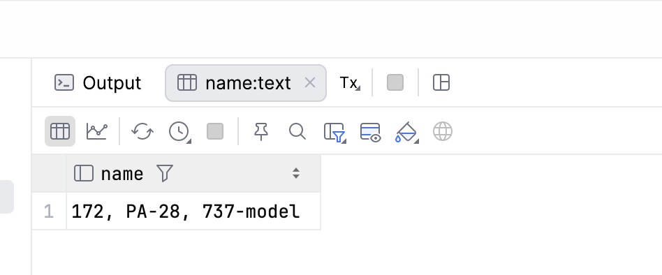

6.2 Вывести строковые значения у car_model
select string_agg(name , ', ') from car_model;
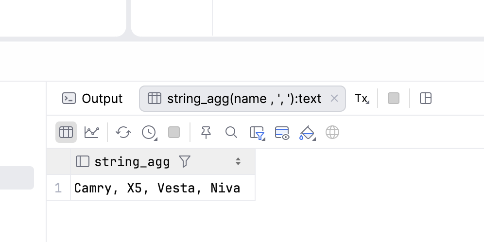

b) 7 - GROUP BY()

7.1 для каждого количества дверей вывести, сколько моделей машин его имеют
select doors_count, count(*) from car_model group by doors_count
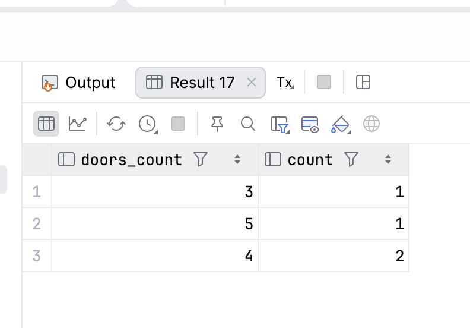

7.2 для каждой вместимости самолета вывести, сколько моделей самолетов его имеют
select capacity, count(*) from airplane_model group by capacity
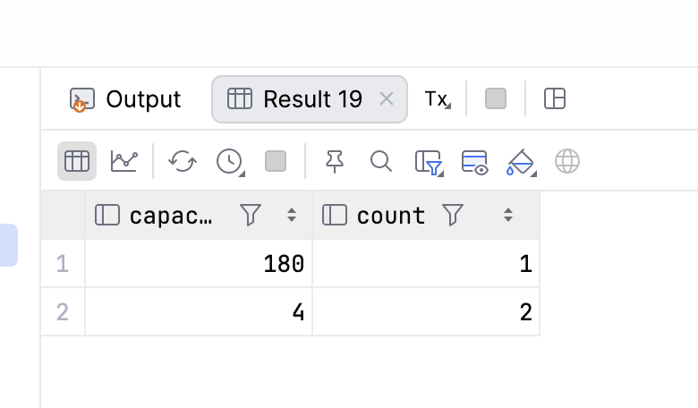

8 - HAVING()

8.1 для каждого количества дверей вывести число моделей машин, у которых
столько дверей, оставив только те варианты, где такая модель одна
select doors_count, count(*) from car_model group by doors_count having count(*) = 1
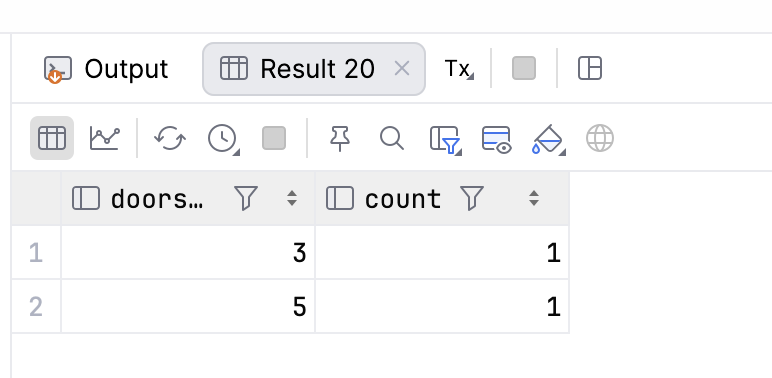

8.2 для каждой вместимости самолета вывести число моделей самолетов, у которых такая 
вместимости, оставив только те варианты, где вместимость больше одной
select capacity, count(*) from airplane_model group by capacity having count(*) > 1;
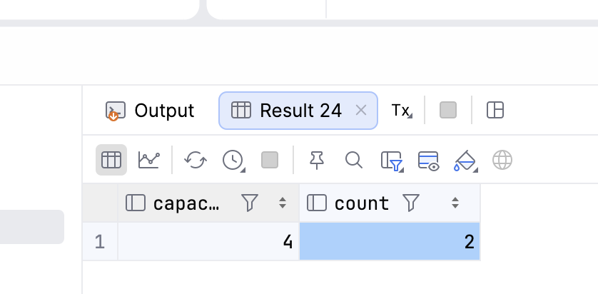

c) 9 - GROUPING SETS

9.1 посчитать количество моделей машин отдельно по каждому бренду и отдельно по 
каждому количеству дверей
select brand_id, doors_count, count(*) from car_model group by grouping sets (brand_id, doors_count)
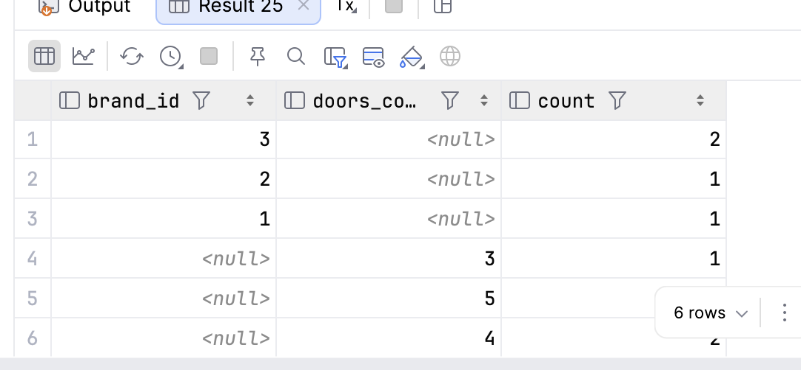

9.2 посчитать количество моделей самолетов отдельно по каждому бренду и отдельно по
каждой вместимости 
select brand_id, capacity, count(*) from airplane_model group by grouping sets (brand_id, capacity)
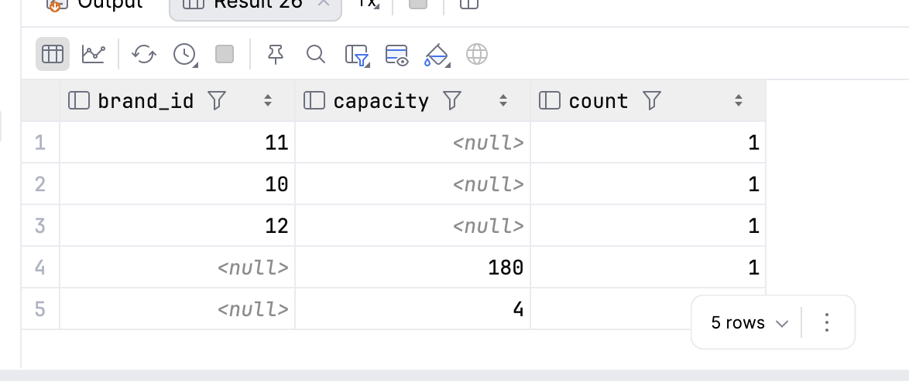

10 - ROLLUP()

10.1 посчитать количество моделей машин по каждому бренду с разбивкой по количеству дверей
select brand_id, doors_count, count(*) as "Кол-во моделей" from car_model group by rollup (brand_id, doors_count)
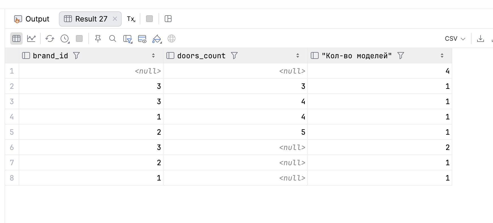

10.2 посчитать количество моделей велосипедов по каждому бренду с разбивкой на кол-во скоростей
select brand_id, speeds_count, count(*) as "Кол-во моделей" from bike_model group by rollup (brand_id, speeds_count)
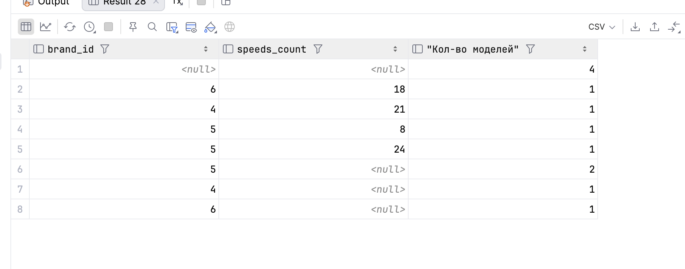

11 - CUBE()

11.1 Посчитать количество моделей машин во всех комбинациях бренда и количества дверей: для каждой пары, отдельно для каждого бренда, отдельно для каждого количества дверей и общее количество
select brand_id, doors_count, count(*) as "Кол-во моделей" from car_model
group by cube (brand_id, doors_count) 
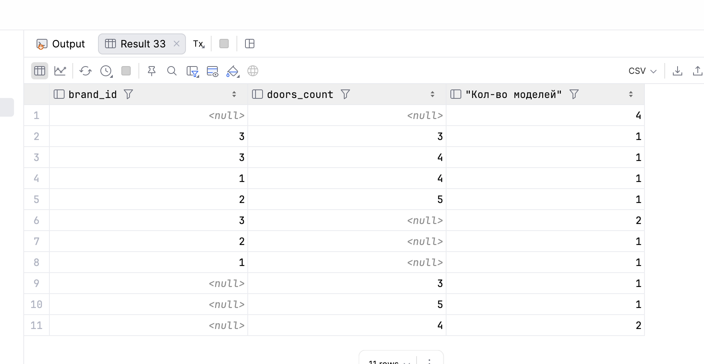

11.2 Посчитать количество моделей самолётов во всех комбинациях бренда и вместимости: для каждой пары, отдельно для каждого бренда, отдельно для каждой вместимости и общее количество
select brand_id, capacity, count(*) as "Кол-во моделей"from airplane_model
group by cube (brand_id, capacity) 
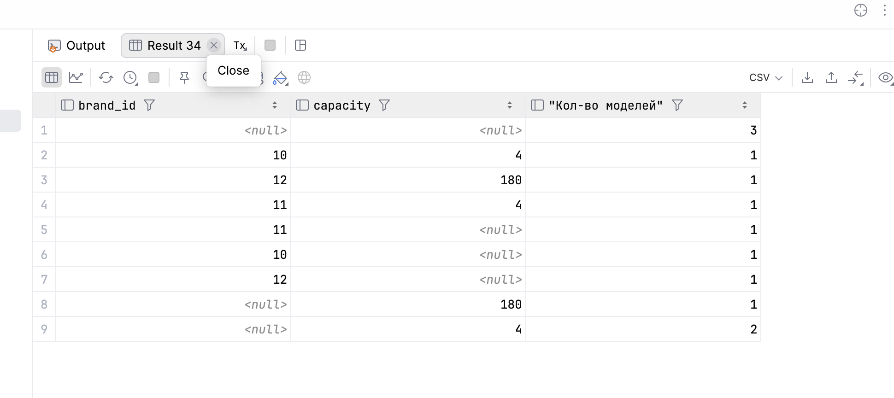

12 - SELECT, FROM, WHERE, GROUP BY, HAVING, ORDER BY

12.1 cреди моделей машин, у которых 4 и более дверей, для каждого количества 
дверей вывести число моделей и их названия, оставить только те варианты, 
где моделей больше одной, отсортировать по количеству дверей
select doors_count, count(*) from car_model
where doors_count > 4
group by doors_count
having count(*) > 1
order by doors_count
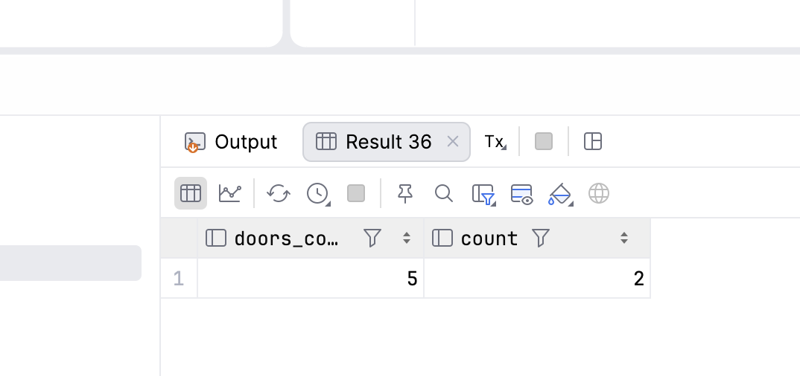

12.2 Среди машин, у которых 4 и более дверей, для каждого владельца
вывести количество машин и их номера, оставить только владельцев, 
у которых больше одной машины, отсортировать по количеству машин по убыванию
select o.last_name, count(*)
from car c
join owner o on c.owner_id = o.owner_id
join car_model cm on c.car_model_id = cm.car_model_id
where cm.doors_count >= 4
group by o.last_name
having count(*) > 1
order by count(*) desc
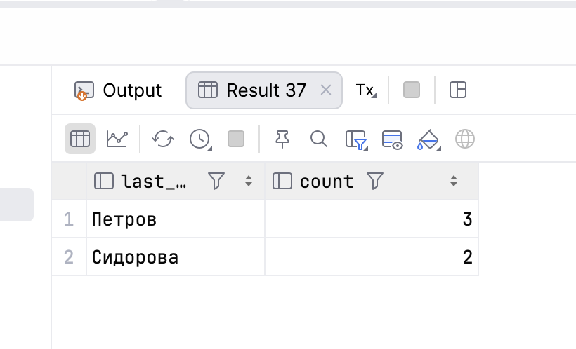