1) SELECT

1.1 Вывести количество машин у каждого владельца
select o.first_name, o.last_name,
(select count(*) from car c where c.owner_id = o.owner_id)
as "Количество машин" from owner o;
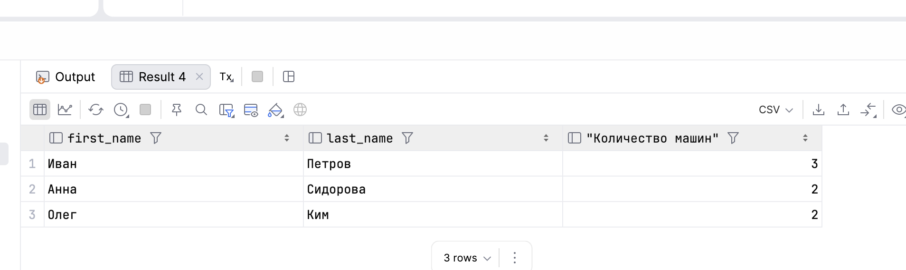

1.2 Количество велосипедов каждой модели
select bm.name,(select count(*) from bike b where b.bike_model_id = bm.bike_model_id)
as "Количество велосипедов" from bike_model bm join brand b on bm.brand_id = b.brand_id;
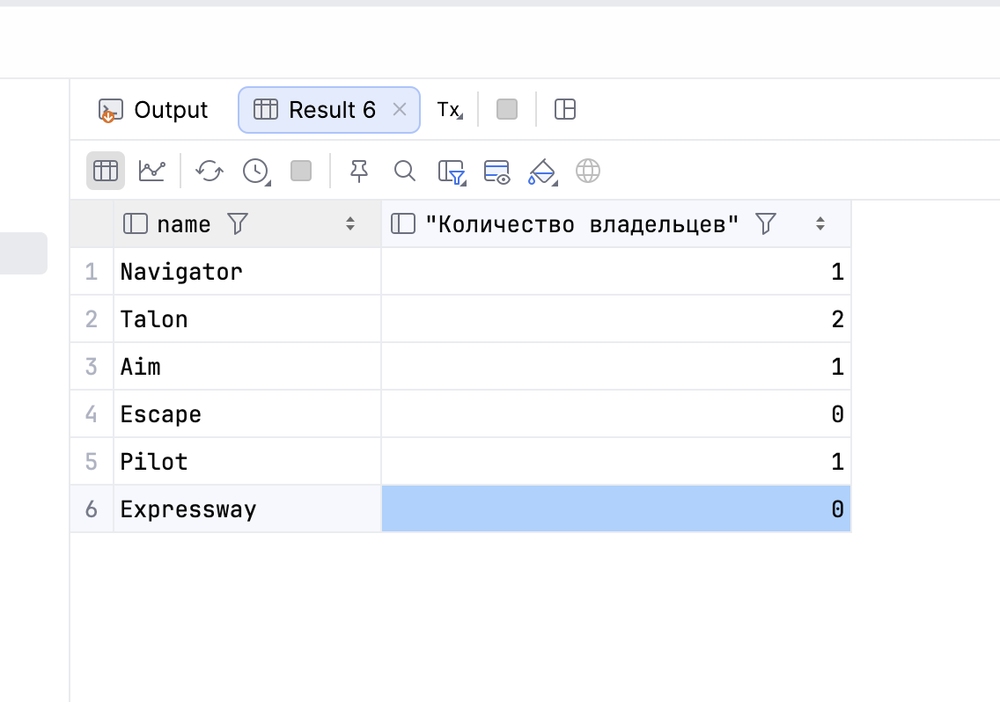

2) FROM

2.1 Вывести имя, фамилию владельца и количество его машин.
select o.first_name, o.last_name, cars."Car count" from owner o join
(select car.owner_id, count(*) as "Car count" from car group by owner_id) as cars
on cars.owner_id = o.owner_id;
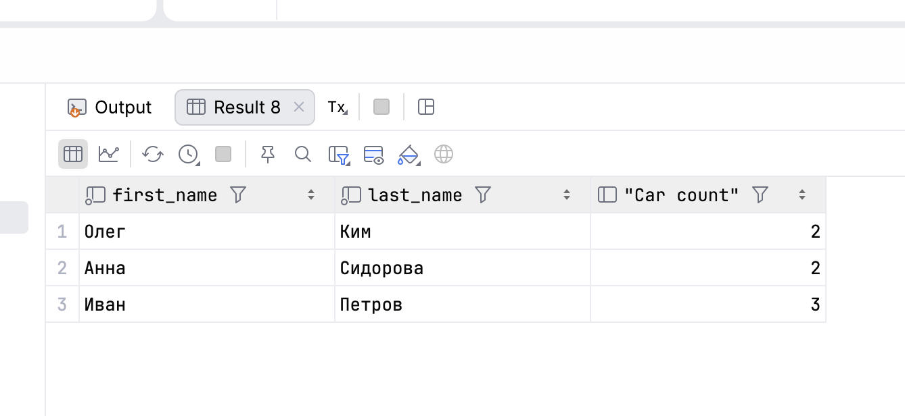

2.2 Вывести марки велосипедов и среднее количество скоростей у их моделей.
select b.name, speed_count.avg_speed from brand b join
(select bike_model.brand_id, AVG(bike_model.speeds_count) as avg_speed from bike_model group by brand_id)
as speed_count
on b.brand_id = speed_count.brand_id;
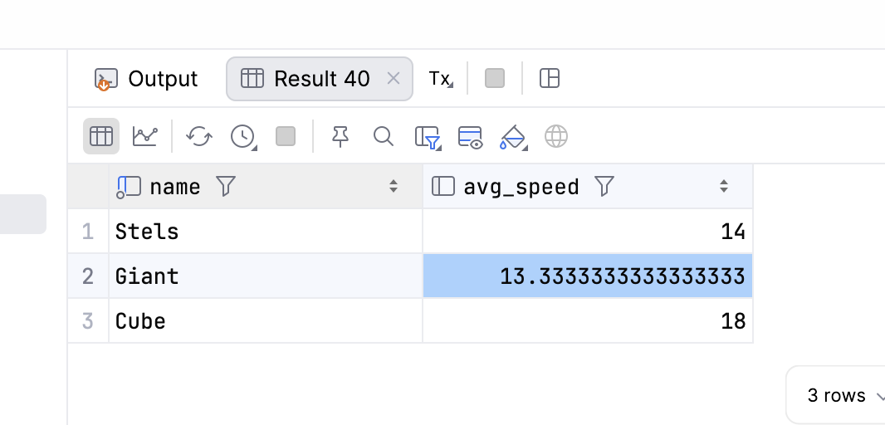

3) WHERE 

3.1 Вывести автомобили с максимальным количеством дверей.
select b.name, cm.name from brand b join car_model cm on b.brand_id = cm.brand_id
where cm.doors_count = (select max(doors_count) from car_model)
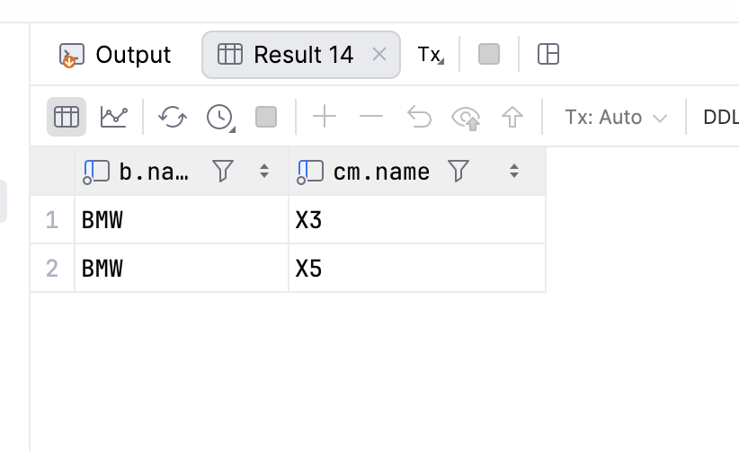

3.2 Вывести модели мотоциклов, объём двигателя которых выше среднего объёма всех мотоциклов.
select bm.name from motorbike_model bm where bm.engine_cc > (select avg(engine_cc) from motorbike_model)
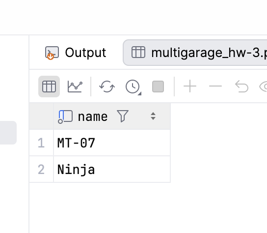

4) HAVING

4.1 Вывести бренды автомобилей, у которых среднее количество
дверей больше среднего количества дверей у всех моделей автомобилей.
select b.name from brand b join
car_model cm on b.brand_id = cm.brand_id group by b.name
having avg(cm.doors_count) > (select avg(doors_count) from car_model)
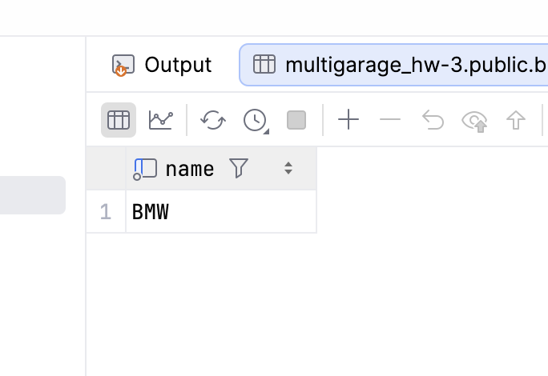

4.2 Вывести владельцев, у которых количество машин больше
среднего количества машин среди владельцев, имеющих хотя бы одну машину.
select o.owner_id, o.first_name, o.last_name, count(c.car_id) as car_count from owner o
join car c on o.owner_id = c.owner_id group by o.owner_id, o.first_name, o.last_name
having count(c.car_id) > (select avg(car_count) from (select owner_id, count(*) as car_count
from car group by owner_id) as car_stats)
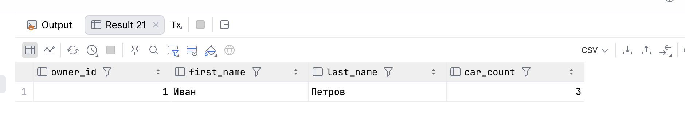

5) ALL

5.1 Вывести модели мотоциклов, объём двигателя которых больше, чем у всех мотоциклов бренда Honda
select bm.name from motorbike_model bm join brand b on b.brand_id = bm.brand_id
where bm.engine_cc > all
(select bm2.engine_cc from motorbike_model bm2 join brand b on bm2.brand_id = b.brand_id
where b.name = 'Honda')
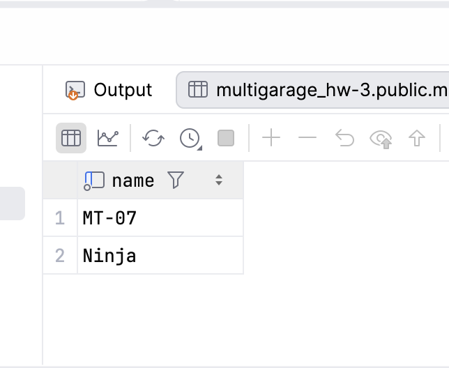

5.2 Вывести модели велосипедов, у которых количество скоростей меньше, чем у всех моделей бренда Giant.
select bm.name from bike_model bm join brand b on b.brand_id = bm.brand_id
where bm.speeds_count < all
(select bm2.speeds_count from bike_model bm2 join brand b2 on b2.brand_id = bm2.brand_id
where b2.name = 'Giant')
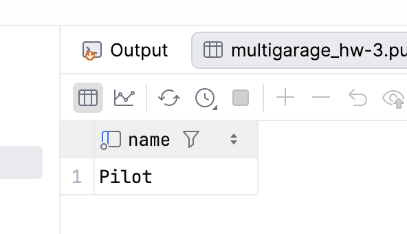

6) IN

6.1 Вывести имена и фамилии владельцев, у которых есть хотя бы один велосипед.
select o.first_name, o.last_name from owner o where owner_id in (select owner_id from bike)
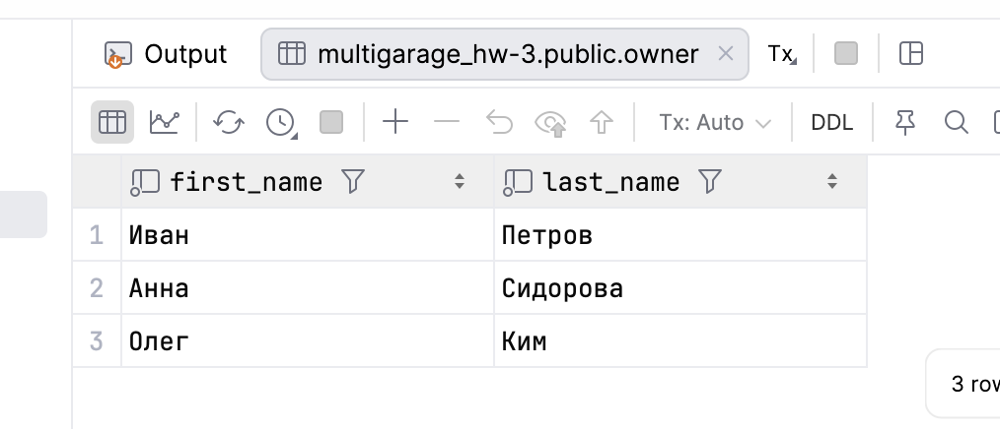

6.2 Вывести названия моделей автомобилей брендов Toyota и BMW
select name from car_model where brand_id in
(select brand.brand_id from brand where brand.name = 'BMW' or brand.name = 'Toyota')
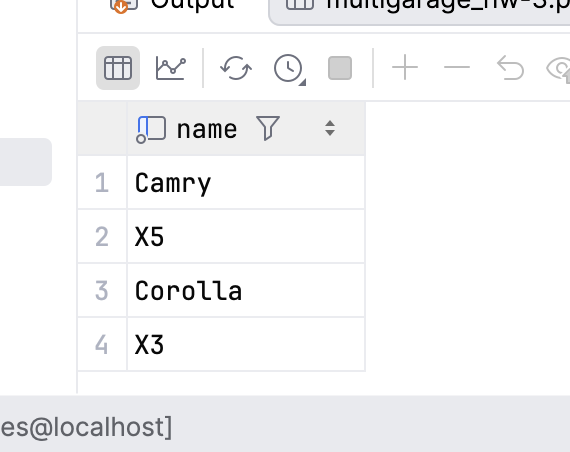

7) ANY

7.1 Вывести названия моделей велосипедов, у которых количество скоростей больше, 
чем хотя бы у одной модели бренда Giant
select bm.name from bike_model bm where bm.speeds_count > any
(select bm2.speeds_count from bike_model bm2 join brand b on b.brand_id = bm2.brand_id
where b.name = 'Giant')
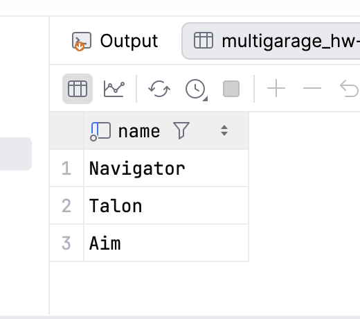

7.2 Вывести названия моделей мотоциклов, у которых объём двигателя меньше, 
чем хотя бы у одной модели бренда Honda.
select mm.name from motorbike_model mm where mm.engine_cc < any
(select mm2.engine_cc from motorbike_model mm2 join brand b on b.brand_id = mm2.brand_id
where b.name = 'Honda')
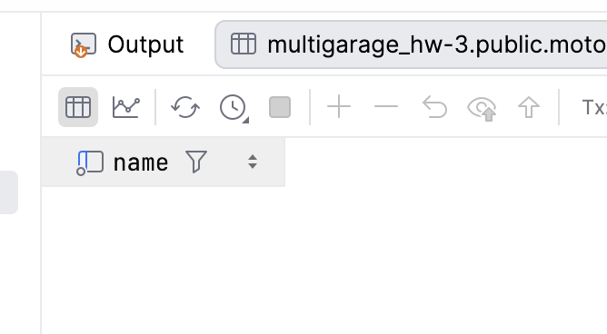

8) EXIST

8.1 Вывести имена и фамилии владельцев, у которых есть хотя бы один самолёт
select o.first_name, o.last_name from owner o where exists
(select 1 from airplane a where o.owner_id = a.owner_id)
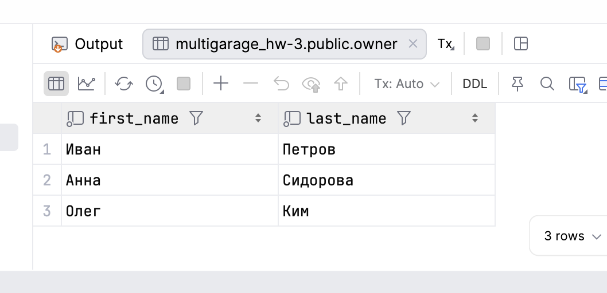

8.2 Вывести названия моделей автомобилей, которых нет ни у одного владельца
select cm.name from car_model cm where not exists
(select 1 from car c where c.car_model_id = cm.car_model_id)
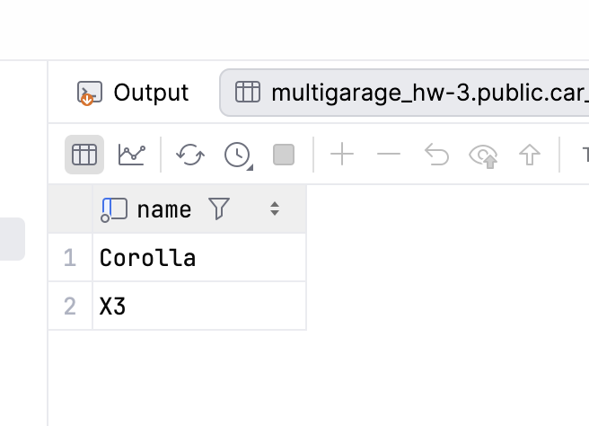

9) Сравнение по нескольким столбацам

9.1 Вывести названия моделей велосипедов, у которых бренд и количество 
скоростей совпадают с какой-либо моделью Talon
select bm.name from bike_model bm where(bm.brand_id, bm.speeds_count) in
(select bm2.brand_id, bm2.speeds_count from bike_model bm2 where bm2.name = 'Talon')
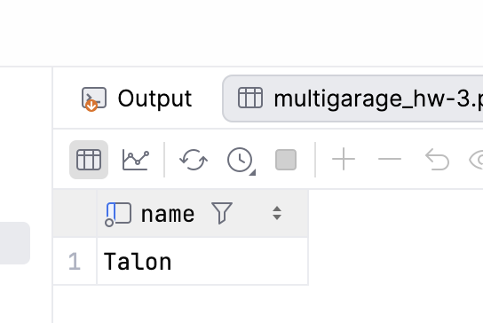

9.2 Вывести названия моделей мотоциклов, у которых бренд и объём двигателя совпадают 
с какой-либо моделью Ninja
select bm.name from public.motorbike_model bm where (bm.brand_id, bm.engine_cc) in
(select bm2.brand_id, bm2.engine_cc from motorbike_model bm2 where bm2.name = 'Ninja')
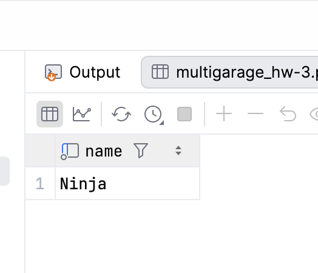

10) Коррелированные запросы

10.1 Вывести имя, фамилию и количество велосипедов каждого владельца, 
включая владельцев без велосипедов.
select o.first_name, o.last_name,
(select count(*) from bike b where b.owner_id = o.owner_id ) as bike_count
from owner o
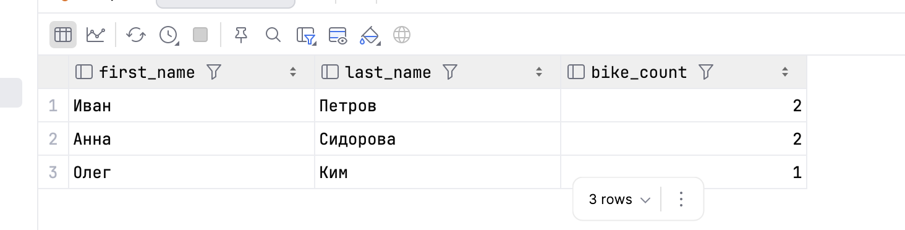

10.2 Вывести названия моделей мотоциклов, объём двигателя которых выше среднего 
среди моделей того же бренда.
select mm.name from motorbike_model mm where mm.engine_cc >
(select avg(mm2.engine_cc) from motorbike_model mm2 where mm.brand_id = mm2.brand_id)
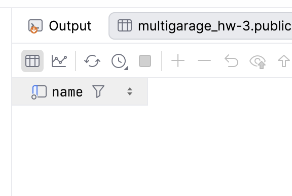

10.3 Вывести имя и фамилию владельцев, у которых есть хотя бы одна лодка.
select o.first_name, o.last_name from owner o where exists
(select 1 from boat where boat.owner_id = o.owner_id)
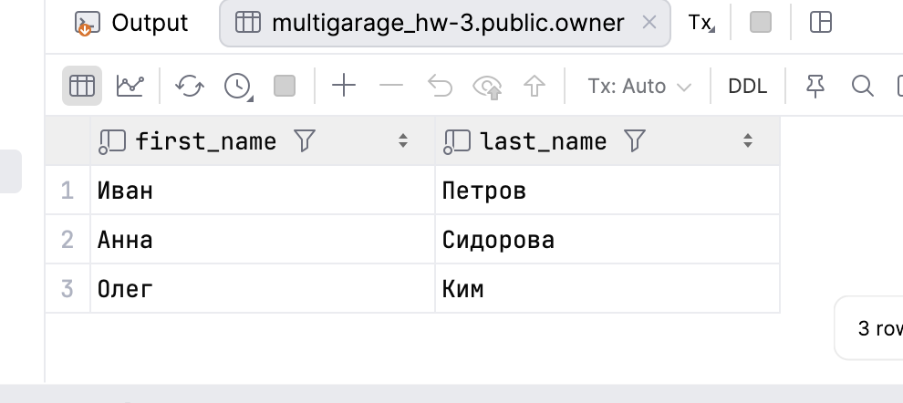

10.4 Вывести названия брендов, у которых нет ни одной модели автомобиля.
select b.name from brand b where not exists
(select 1 from car_model cm where cm.brand_id = b.brand_id)
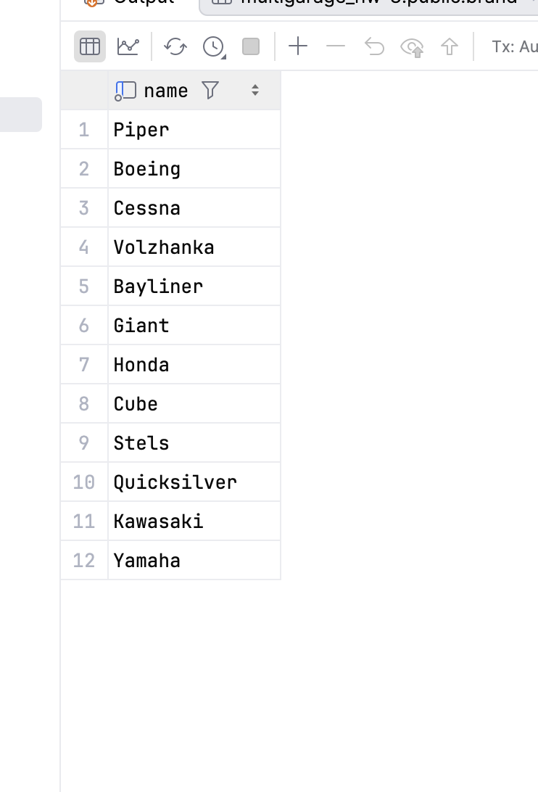

10.5 Вывести названия моделей самолётов с максимальной вместимостью внутри своего бренда
select am1.name from airplane_model am1 where am1.capacity =
(select max(capacity) from airplane_model am2 where am2.brand_id = am1.brand_id)
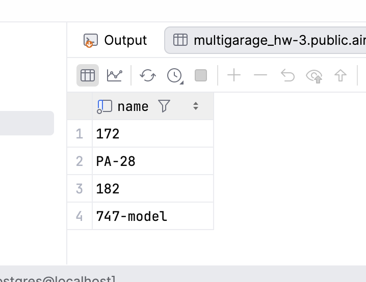
