1) BEGIN COMMIT

1.1 begin;

insert into car (owner_id, car_model_id, plate_number)
values(1,1, 'B444BB');

update owner set phone = '89870650466' where owner_id = 1;

commit;

1.2 begin;

insert into bike(owner_id, bike_model_id) values(2, 2);
update owner set last_name = 'Овечкин' where owner_id = 2;

commit;

2) BEGIN ROLLBACK

2.1 begin;

insert into car (owner_id, car_model_id, plate_number)
values(1,1, 'М888ММ');

update owner set phone = '89870650466' where owner_id = 1;

rollback;

2.2 begin;

insert into airplane (owner_id, airplane_model_id)
values (3, 2);

update airplane_model set name = 'Airbus340' where airplane_model_id = 2;

rollback;

3) Деление на 0

В конце транзакции добавил SELECT 1 / 0;. 
PostgreSQL выдал ошибку деления на ноль. 
После ROLLBACK количество самолётов и название модели остались прежними.

УРОВЕНЬ ИЗОЛЯЦИИ

4) READ UNCOMMITTED / READ COMMITTED

4.1 
Т1 - Меняю имя владельца и оставляю транзакцию открытой
begin;
update owner set first_name = 'Тест' where owner_id = 3 returning first_name;

Т2 - Проверка имени на read uncommited
begin isolation level read uncommitted;
select first_name from owner where owner_id = 3;
commit;
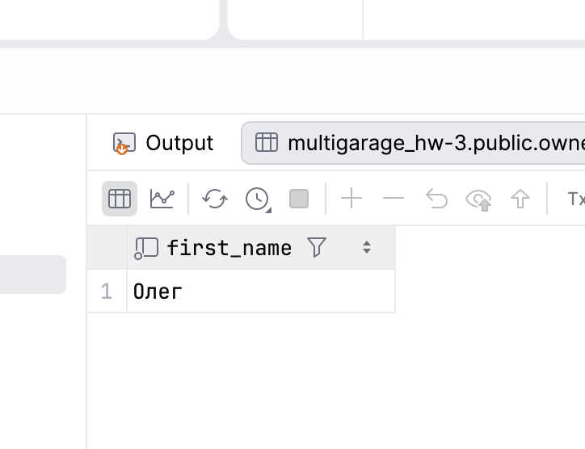

Т2 - Проверка имени на read commited
begin isolation level read committed;
select first_name from owner where owner_id = 3;
commit;
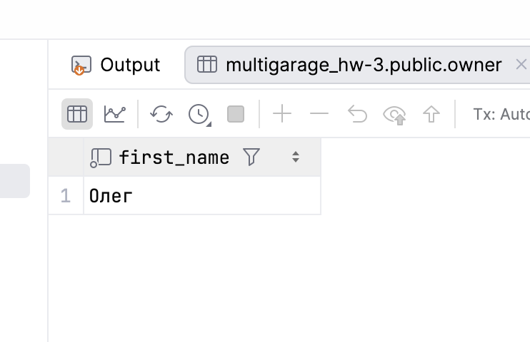

Т1 - Отменяю замену имени

5) READ COMMITTED

Т1 - Выполняю первый select
begin isolation level read committed;
select owner.first_name from owner where owner_id = 3;
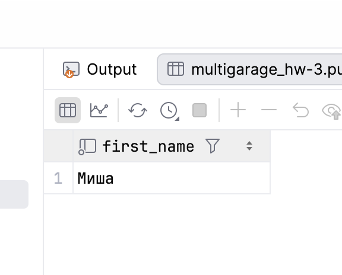

Т2 - Делаю update
begin;
update owner set first_name = 'Иван' where owner_id = 3;
commit;

Т1 - Выполняю второй select
select owner.first_name from owner where owner_id = 3;
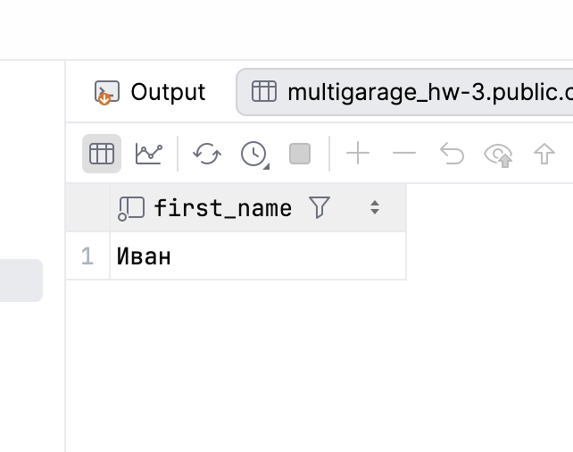

6) REPEATABLE READ

6.1

Т1 - Читаю имя и оставляю транзакцию открытой
begin isolation level repeatable read;
select first_name from owner where owner_id = 3;

Т2 - Меняю имя пользователя
begin;
update owner set first_name = 'Миша' where owner_id = 3;
commit;

Т1 - select до commit
select first_name from owner where owner_id = 3;
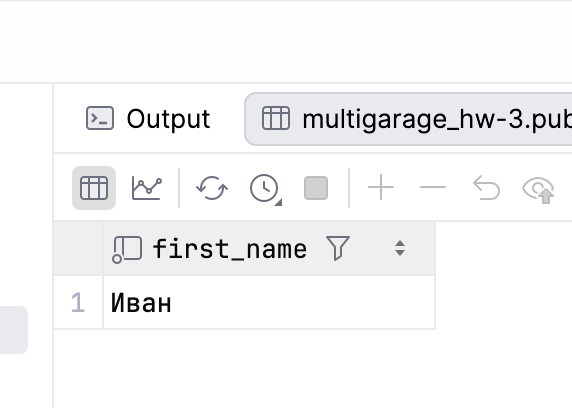

Т1 - select после commit
commit;
select first_name from owner where owner_id = 3;
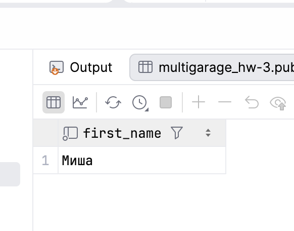

6.2 

Т1 - смотрим список велосипедов у владельца
begin isolation level repeatable read;
select bike_id from bike where owner_id = 3 order by bike_id;
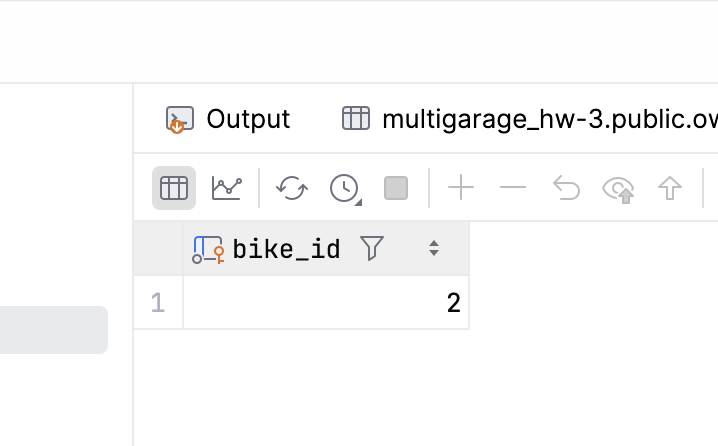

Т2 - Добавляем велосипед этому же владельцу
begin;
insert into bike (owner_id, bike_model_id) values(3,3) returning bike_id;
commit;
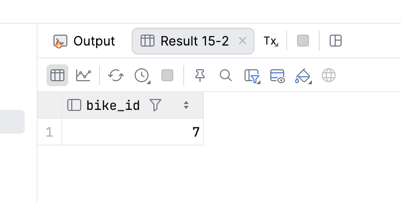

Т1 - Смотрим до коммита
select bike_id from bike where owner_id = 3 order by bike_id;
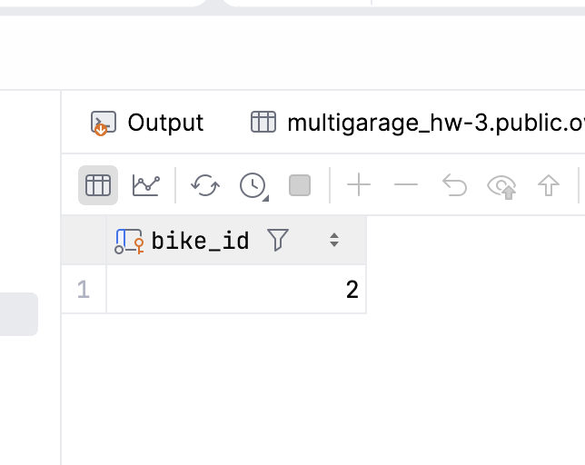

Т1 - Смотрим после коммита
commit;
select bike_id from bike where owner_id = 3 order by bike_id;
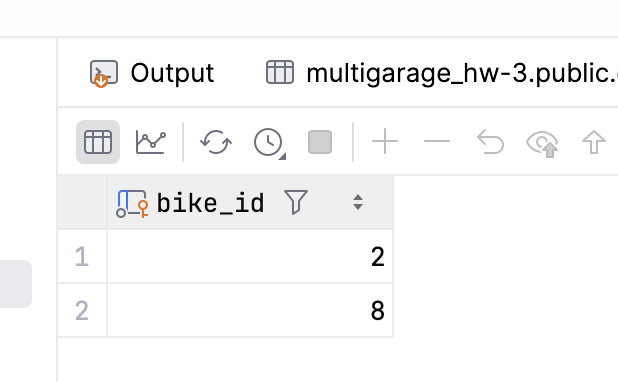

7) Serializable

7.1) Смоделируй конфликт: две транзакции вставляют одинаковые данные.

Т1 - Добавляем новую машину с номером У000УУ
begin isolation level serializable;
insert into car (owner_id, car_model_id, plate_number)
values (2, 1, 'У000УУ');

Т2 - делаем тоже самое в другой консоли
begin isolation level serializable;
insert into car (owner_id, car_model_id, plate_number)
values (2, 1, 'У000УУ');

т1 - делаем commit - в итоге ошибка
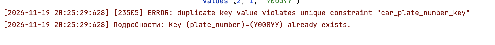

7.2) Поймай ошибку could not serialize access due to concurrent update и повтори транзакцию

Т1 - Меняем имя владельцу с id = 3
begin isolation level serializable;
update owner set first_name = 'Тимур' where owner_id = 3;

Т2 - Делаем тоже самое в другой консоли, только ставим другое имя - транзакция ждет первый терминал
begin isolation level serializable;
update owner set first_name = 'Паша' where owner_id = 3;

Т1 - делаем commit -  ERROR: could not serialize access due to concurrent update
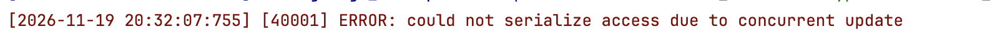

Т2 - rollback и повторяем транзакцию после commit в первом терминале
rollback;
begin isolation level serializable;
update owner set first_name = 'Паша' where owner_id = 3 returning first_name;
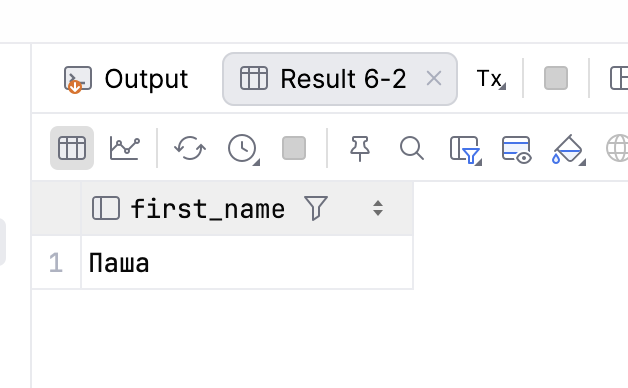

8) SAVEPOINT

8.1) Создай транзакцию с несколькими изменениями и точкой сохранения.
— Убедись, что изменения до SAVEPOINT остались.

begin;

select phone, first_name from owner where owner_id = 3;

update owner set first_name = 'Грига' where owner_id = 3;
savepoint name_point;

update owner set phone = '+88888888888' where owner_id = 3
returning phone;

rollback to name_point;

select phone, first_name from owner where owner_id = 3;

commit;
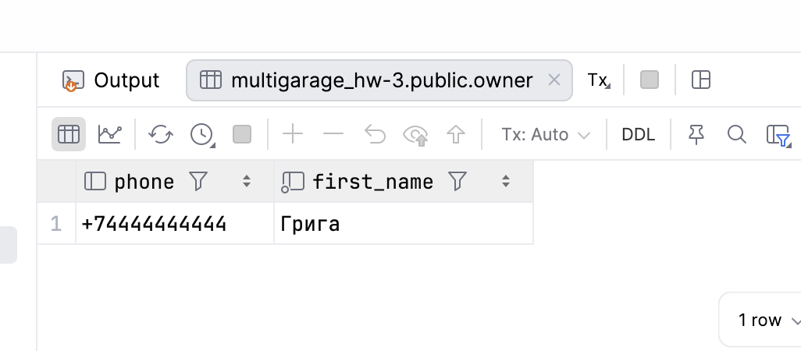

8.2) Добавь два SAVEPOINT, попробуй вернуть на первый и второй.

begin;

select last_name from owner where owner_id = 3;

update owner set last_name = 'Каримов' where owner_id = 3;
savepoint point_1;

update owner set last_name = 'Насыров' where owner_id = 3;
savepoint point_2;

update owner set last_name = 'Тарасов' where owner_id = 3
returning last_name;

rollback to  point_2;
select last_name from owner where owner_id = 3;

rollback to point_1;
select last_name from owner where owner_id = 3;

commit;

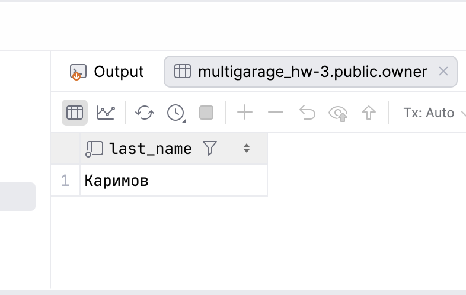

ВЫВОДЫ

readuncommited - может читать незакомииченные изменения.
readcommited читает только закоммиченные изменения.
repeatable read просто выводит в нужную ячейку
serializable позволяет работать двум транзакциям одновременно, но если обе завершились, то
должно быть как будто они выполнились по очереди
savepoint делает точку сохранения к которой можно будет потом откатиться.

