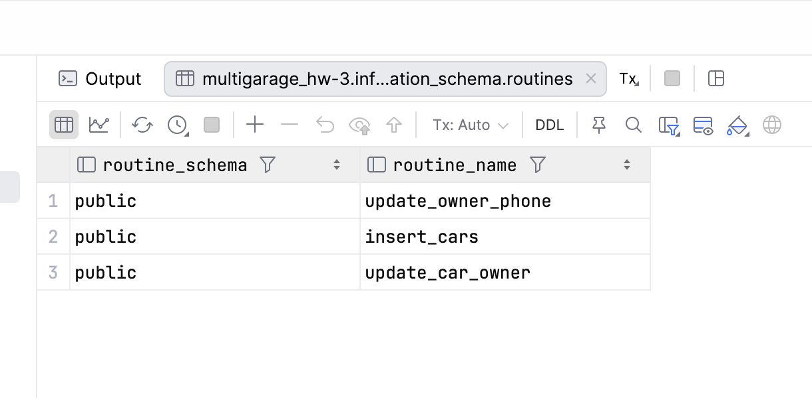
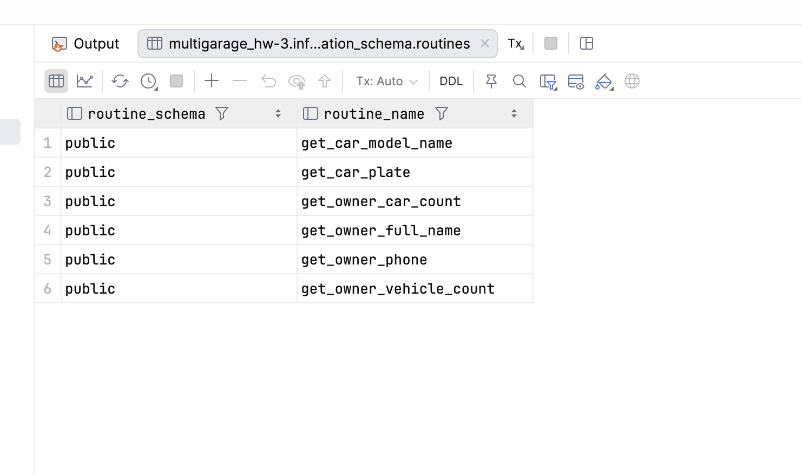
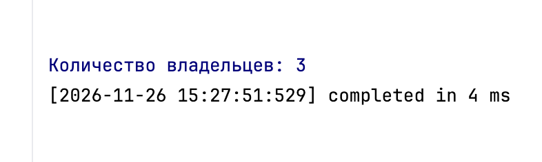
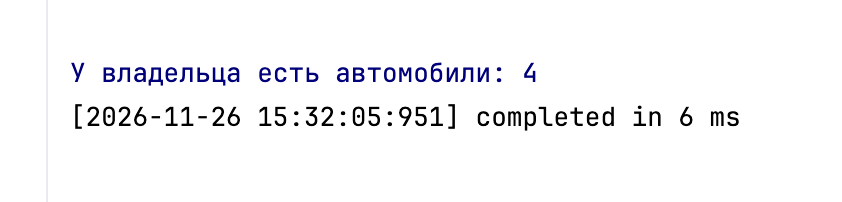
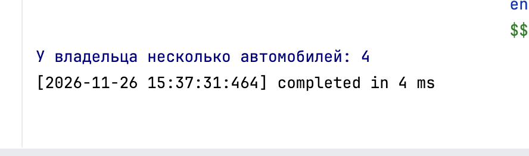
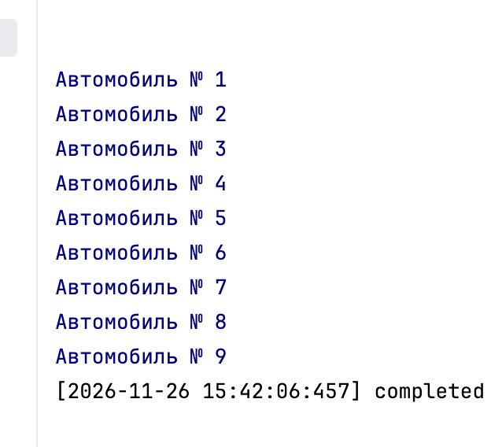
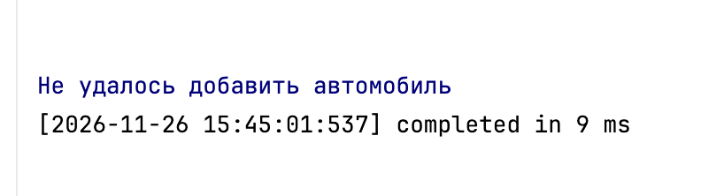
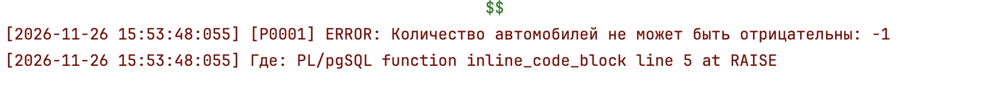

1) Процедуры 

1.1) Изменение телефона владельца

create or replace procedure update_owner_phone (
p_owner_id int,
p_phone varchar(20)
)
language plpgsql
as $$
begin
update owner set phone = p_phone
where owner_id = p_owner_id;
end;
$$;

1.2) Добавление автомобиля

create or replace procedure insert_cars (
p_owner_id int,
p_car_model_id int,
p_plate_number varchar(20)
)
language plpgsql
as $$
begin
insert into car (owner_id, car_model_id, plate_number)
values (p_owner_id, p_car_model_id,p_plate_number);
end;
$$;

1.3) Передача автомобиля другому владельцу

create or replace procedure update_car_owner (
p_car_id int,
p_owner_id int
)
language plpgsql
as $$
begin
update car set owner_id = p_owner_id where car_id = p_car_id;
end;
$$;

1.4 Запрос просмотра всех процедур
select routine_schema, routine_name from information_schema.routines
where routine_type = 'PROCEDURE';

2)

2.1) Функции

2.1.1) Получить телефон владельца

create or replace function get_owner_phone (
f_owner_id int
)
returns varchar
language sql
as $$
select phone from owner where owner_id = f_owner_id;
$$;

2.1.2) Посчитать автомобили владельца

create or replace function get_owner_car_count (
f_owner_id int
)
returns bigint
language sql
as $$
select count(*) from car where owner_id = f_owner_id
$$

2.1.3) Получить госномер автомобиля

create or replace function get_car_plate (
f_car_id int
)
returns varchar
language sql
as $$
select plate_number from car where car_id = f_car_id;
$$;

2.2.1) Полное имя владельца

create or replace function get_owner_full_name (
f_owner_id int
)
returns text
language plpgsql
as $$
declare v_full_name text;
begin
select first_name || ' ' || last_name into v_full_name from owner where owner_id = f_owner_id;
return v_full_name;
end;
$$;

2.2.2) Название модели автомобиля

create or replace function get_car_model_name (
f_car_id int
`)`
returns varchar
language plpgsql
as $$
declare v_name varchar(50);
begin
select name into v_name from car_model cm join car c on cm.car_model_id = c.car_model_id
where car_id = f_car_id;
return v_name;
end;
$$;

2.2.3) Количество всего транспорта владельца

create or replace function get_owner_vehicle_count (
f_owner_id int
)
returns bigint
language plpgsql
as
$$
declare
v_car_count bigint;
v_bike_count bigint;
v_airplane_count bigint;
v_motorbike_count bigint;
v_boat_count bigint;
begin
select count(*) into v_car_count from car where owner_id = f_owner_id;
select count(*) into v_bike_count from bike where owner_id = f_owner_id;
select count(*) into v_airplane_count from airplane where owner_id = f_owner_id;
select count(*) into v_motorbike_count from motorbike where owner_id = f_owner_id;
select count(*) into v_boat_count from boat where owner_id = f_owner_id;
return v_boat_count + v_motorbike_count + v_airplane_count + v_bike_count + v_car_count;
end;
$$;

2.3) Запрос просмотра всех функций

select routine_schema, routine_name
from information_schema.routines
where routine_type = 'FUNCTION' and routine_schema = 'public'
order by routine_schema, routine_name;

3) DO - Блок DO, который посчитает всех владельцев и выведет их количество

do $$
declare v_count_owner bigint;
begin
select count(*) into v_count_owner from owner;
raise notice 'Количество владельцев: %', v_count_owner;
end;
$$;

4) IF - Есть ли у владельца автомобили

do $$
declare v_car_count bigint;
begin
select count(*) into v_car_count from car where owner_id = 1;
if v_car_count > 0 then
raise notice 'У владельца есть автомобили: %', v_car_count;
else
raise notice 'У владельца нет автомобилей';
end if;
end;
$$;

5) CASE - Вывести сообщение в зависимости от количества автомобилей владельца

do $$
declare v_car_count bigint;
begin
select count(*) into v_car_count from car where owner_id = 1;
        case
            when v_car_count = 0 then
            raise notice 'У владельца нет автомобилей';
            when v_car_count = 1 then
            raise notice 'У владельца 1 автомобиль';
            else
            raise notice 'У владельца несколько автомобилей: %', v_car_count;
        end case;
    end;
    $$

6) WHILE - вывести числа от 1 до количества автомобилей в базе

do $$
declare
v_car_count bigint;
v_counter bigint := 1;
begin
select count(*) into v_car_count from car;
while v_counter <= v_car_count loop
raise notice 'Автомобиль № %', v_counter;
v_counter := v_counter + 1;
end loop;
end;
$$;

7) EXCEPTIONS - Добавить автомобиль с владельцем, которого нет в базе

do $$
begin
insert into car (owner_id, car_model_id, plate_number) values (-1, 1, 'И999ИИ');
exception
when foreign_key_violation then raise notice 'Не удалось добавить автомобиль';
end;
$$

8) RAISE - проверить значение количества автомобилей

   do $$
   declare v_car_count bigint := -1;
   begin
   if v_car_count < 0 then
   raise exception 'Количество автомобилей не может быть отрицательны: %', v_car_count;
   end if;
   raise notice 'Количество автомобилей: %', v_car_count;
   end;
   $$

